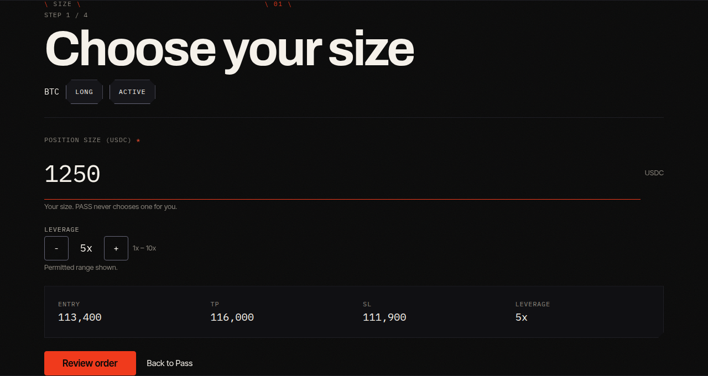
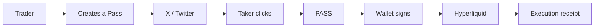

<p align="center">
  
</p>

<h1 align="center">PASS</h1>

<p align="center">
  <strong>See a trade. Know the trader. Take the trade.</strong>
</p>

<p align="center">
  <a href="https://pass-web-dun.vercel.app"></a>
  <a href="./LICENSE"></a>
  
  
</p>

PASS is a **social execution layer for Hyperliquid**. A trader publishes a
trade plan as a shareable **Pass**. A taker reads the plan, chooses their own
size, and authorizes it with their own wallet. The plan is public. The
execution is self-custodial.

---

## The problem

Trading alpha lives on Crypto Twitter, but the trade does not. By the time you
leave the timeline, open an exchange, and rebuild the position, the price has
moved. Copy-trading bots solve the speed problem by holding your funds and
asking you to trust their custody.

There should be a way to turn a public trade idea into an executable plan
without handing over a private key.

## The solution

**PASS turns a trade plan into a shareable, executable link.** The trader
publishes the thesis, levels, expiry, and risk. The taker chooses their own
size and signs the order from their own wallet. PASS relays the signed action
to Hyperliquid and records the execution against the exact Pass version that
was live when it was taken.

- **Non-custodial.** PASS never holds funds, seed phrases, or private keys.
- **Trader-led.** The plan is the public object; the size is the taker's call.
- **Auditable.** Every execution names the Pass version and provider order id.
- **Social.** Share the Pass on X and let the timeline execute with context.

---

## Screenshots

<p align="center">
  
</p>

**A Pass in Discover.** One plan, its levels, live status, and the taker's
entry point.

<p align="center">
  
</p>

**The Take flow.** The taker chooses the size; PASS previews the exact order
and fees before anything is signed.

<p align="center">
  
</p>

**Mobile.** The hero and CTAs alone — the desktop phone mockup is hidden on
phones.

> **Screenshot brief for future updates:** keep these three images targeted.
> `pass-card.png` is a single Discover card, not the full Discover page.
> `take-modal.png` is the Take flow at size selection or preview.
> `mobile.png` is the 375px hero with the phone mockup hidden. Replace the
> files in `public/readme/` and keep the same paths.

---

## How it works



1. The **Trader** connects X and publishes a Pass: asset, direction, entry,
   take profit, stop loss, leverage, thesis, and expiry.
2. The Pass is shared on **X** as a public link.
3. The **Taker** opens the Pass, reads the thesis, and chooses their own size.
4. PASS previews the exact order and fees. The taker's **wallet signs**.
5. **Hyperliquid** executes. PASS records the receipt against the Pass version.

Prediction markets use the same flow with binary HIP-4 YES/NO outcomes and
USDH collateral.

---

## For Traders

No clone. No terminal. Just the live app.

1. Open [pass-web-dun.vercel.app](https://pass-web-dun.vercel.app).
2. **Connect X** — your PASS identity is X-only.
3. Go to **Discover** and open a Pass. Read the thesis, levels, and expiry.
4. Connect your wallet when you are ready to take the trade.
5. Enter **your** position size. PASS previews the order and the 0.05% builder
   fee.
6. On your first take, approve a Hyperliquid agent key that can place and
   cancel trades only. Then authorize the order.
7. Your execution appears under **Executions**. If the account is empty,
   PASS shows a deposit card instead of a raw venue error.

You can also publish your own plan from **Create a Pass**. Publish stays
disabled until the form is valid; the alert names what needs attention.

---

## For Developers

```bash
git clone https://github.com/onyebuchidaniel60/PASS.git
cd PASS
pnpm install
cp .env.example .env.local
pnpm --filter @pass/api dev
pnpm --filter @pass/web dev
```

The API runs on `http://localhost:4000` and the web app on
`http://localhost:3000`. Without `DATABASE_URL`, the API uses embedded PGlite
for local development.

Run the full verification suite:

```bash
pnpm test
pnpm -r typecheck
pnpm lint
```

The production web build uses `apps/web/.env.production`. The extension uses
`apps/extension/.env.production`.

---

## Tech stack

| Layer | Choice |
|---|---|
| Web | Next.js 15, React 19, TypeScript |
| API | Fastify, Zod, Drizzle ORM |
| Database | Supabase Postgres; embedded PGlite locally |
| Execution | Hyperliquid API, client-signed actions |
| Funding | NEAR Intents / 1Click confidential cross-chain USDC |
| Extension | Chrome MV3, X overlay |
| Design | Custom stageshow system, tokens, editorial typography |

---

## Links

- **Live app:** [pass-web-dun.vercel.app](https://pass-web-dun.vercel.app)
- **Documentation:** [pass-web-dun.vercel.app/docs](https://pass-web-dun.vercel.app/docs)
- **Agent API:** [pass-web-dun.vercel.app/developers](https://pass-web-dun.vercel.app/developers)
- **Docs index:** [docs/README.md](docs/README.md)
- **NEAR Hackathon:** [docs/NEAR_HACKATHON.md](docs/NEAR_HACKATHON.md)

---

## Chrome extension

A pre-built copy is committed at **`apps/extension/dist/`**. Judges and new
users can load it without Node or a build step.

1. Download or clone this repository.
2. Open `chrome://extensions`.
3. Enable **Developer mode**.
4. Click **Load unpacked** and select `apps/extension/dist`.
5. Open x.com in a new tab.

To build from source:

```bash
pnpm install
pnpm --filter @pass/extension build
```

Then reload the unpacked extension in `chrome://extensions`.

---

## Demo video

The 3-minute script, voiceover copy, and shot-by-shot storyboard live in
[`docs/DEMO_VIDEO.md`](docs/DEMO_VIDEO.md).

```bash
ELEVENLABS_API_KEY=...
ELEVENLABS_MODEL_ID=eleven_multilingual_v2
ELEVENLABS_VOICE_ID=...
pnpm generate:voiceover
pnpm video:record
pnpm video:build
```

`pnpm generate:voiceover` writes `public/demo/voiceover.mp3`.
`pnpm video:record` writes the Playwright `.webm` to `public/demo/raw-video/`.
`pnpm video:build` combines the recording, voiceover, and a locally supplied
`public/demo/background.mp3` into `public/demo/demo.mp4`.

The background music is not generated or committed. Add a royalty-free track
you have the right to use.

---

## Repository layout

```text
apps/web          Next.js web app, /docs, /developers
apps/api          Fastify API and in-process worker jobs
apps/extension    Chrome MV3 extension + committed dist/
packages/         Shared contracts, domain, db, integrations, ui
docs/             Source-of-truth documentation
design/           Visual blueprint and local-only reference media
scripts/          Verification, seed, and demo tooling
public/readme     Targeted README screenshots and logo
public/demo       Voiceover and video assembly assets
```

## License

MIT. See [LICENSE](./LICENSE).
