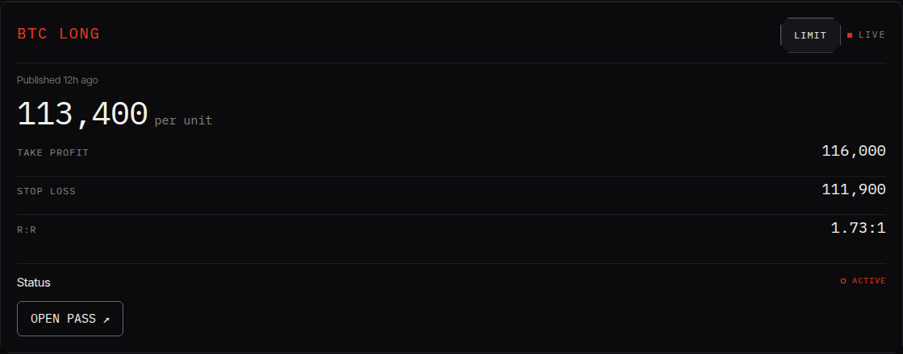
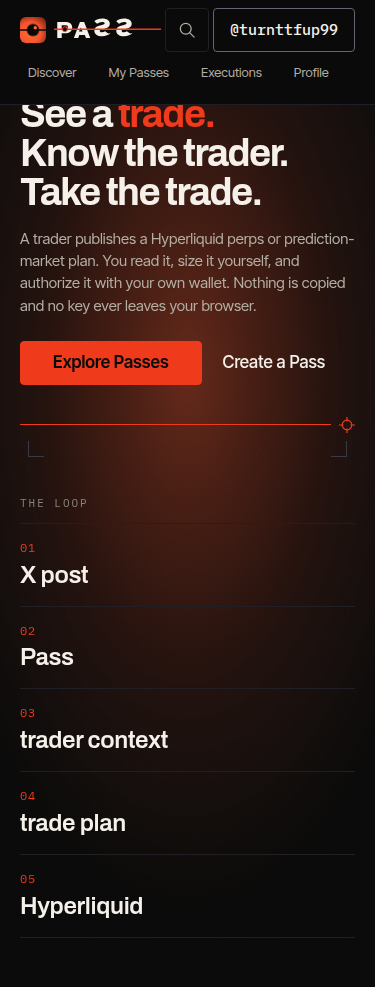
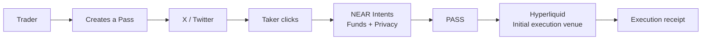

<p align="center">
  
</p>

<h1 align="center">PASS</h1>

<p align="center">
  <strong>PASS is a chain-agnostic social trading protocol built on NEAR's intent infrastructure.</strong>
</p>

<p align="center">
  <em>See a trade. Know the trader. Take the trade.</em>
</p>

<p align="center">
  <a href="https://pass-web-dun.vercel.app"></a>
  <a href="./LICENSE"></a>
  
  
</p>

PASS turns a social trading idea into an executable plan. NEAR Intents handles
the cross-chain funding and privacy layer. Hyperliquid is the first execution
venue. The taker always signs with their own wallet.

---

## The problem

Trading alpha lives on social. Liquidity lives across a dozen chains. The gap
between them is where the trade dies: open the exchange, bridge funds, wait for
confirmations, size the position, and by then the move is gone.

Copy-trading bots promise speed, but they ask for custody of your keys. Every
bridge is another risk surface. Every manual trade is a race. Every custodial
bot is a compromise.

## The solution

**PASS is a chain-agnostic social trading protocol.** A trader publishes a
plan — entry, target, stop, thesis, expiry — as a Pass. A taker sees it on X,
clicks it, and chooses their own size.

NEAR Intents is the core infrastructure:

- **Fund from any chain** without a manual bridge.
- **Route privately through NEAR's confidential shards**, so the funding wallet
  and the trading wallet are never linked on-chain.
- **Sign with your own wallet.** PASS never holds funds or keys.
- **Execute on Hyperliquid**, the initial execution venue, and record the
  receipt against the exact Pass version.

---

## Why NEAR?

### Chain abstraction

Funding is the first friction point in every trade. NEAR Intents turns
cross-chain USDC into one intent: the taker chooses the source chain, and the
funds arrive at the trading account without a manual bridge or a wrapped asset.

### Privacy

NEAR Confidential Intents route the deposit through private shards. The
funding wallet and the trading wallet are not linkable on-chain, which removes
the front-running surface that a public bridge creates.

### Agent economy

The PASS Agent API lets bots discover live Passes and execute pre-signed
orders on NEAR's intent rails. A bot can run headless with a Bearer key while
the wallet remains the signing authority. Social signals become autonomous
strategies without giving an agent custody.

---

## Screenshots

<p align="center">
  
</p>

**A Pass in Discover.** One plan, its levels, live status, and the taker's
entry point.

<p align="center">
  
</p>

**The Take flow.** The taker chooses the size; NEAR Intents funds the account;
the wallet signs.

<p align="center">
  
</p>

**Mobile.** The hero and CTAs alone — the desktop phone mockup is hidden on
phones.

> **Screenshot brief for future updates:** keep these three images targeted.
> `pass-card.png` is a single Discover card, not the full Discover page.
> `take-modal.png` is the Take flow at size selection or preview.
> `mobile.png` is the 375px hero with the phone mockup hidden. Replace the
> files in `public/readme/` and keep the same paths.

---

## How it works



1. The **Trader** connects X and publishes a Pass.
2. The Pass is shared on **X** as a public link.
3. The **Taker** opens it, reads the thesis, and chooses their own size.
4. **NEAR Intents** routes the cross-chain funding privately.
5. The taker's **wallet signs**. **Hyperliquid** executes. PASS records the
   receipt against the Pass version.

Prediction markets use the same flow with binary HIP-4 YES/NO outcomes and
USDH collateral.

---

## For Traders

No clone. No terminal. Just the live app.

1. Open [pass-web-dun.vercel.app](https://pass-web-dun.vercel.app).
2. **Connect X** — your PASS identity is X-only.
3. Go to **Discover** and open a Pass. Read the thesis, levels, and expiry.
4. **Fund from any chain with NEAR Intents.** No manual bridge.
5. Enter **your** position size. PASS previews the order and fee.
6. On your first take, approve a Hyperliquid agent key that can place and
   cancel trades only. Then authorize the order.
7. Your execution appears under **Executions**. If the account is empty,
   PASS shows a deposit card instead of a raw venue error.

You can also publish your own plan from **Create a Pass**. Publish stays
disabled until the form is valid; the alert names what needs attention.

---

## For Developers

```bash
git clone https://github.com/onyebuchidaniel60/PASS.git
cd PASS
pnpm install
cp .env.example .env.local
pnpm --filter @pass/api dev
pnpm --filter @pass/web dev
```

The API runs on `http://localhost:4000` and the web app on
`http://localhost:3000`. Without `DATABASE_URL`, the API uses embedded PGlite
for local development.

Run the full verification suite:

```bash
pnpm test
pnpm -r typecheck
pnpm lint
```

NEAR Intents is configured with `NEAR_INTENTS_MODE`, `NEAR_INTENTS_API_URL`,
and `NEAR_INTENTS_JWT`. The production web build uses
`apps/web/.env.production`; the extension uses
`apps/extension/.env.production`.

---

## Tech stack

| Layer | Choice |
|---|---|
| **NEAR Intents** | **Core infrastructure — chain abstraction, confidential cross-chain funding, intent rails** |
| **Hyperliquid** | **Execution venue — client-signed orders and fills** |
| Web | Next.js 15, React 19, TypeScript |
| API | Fastify, Zod, Drizzle ORM |
| Database | Supabase Postgres; embedded PGlite locally |
| Extension | Chrome MV3, X overlay |
| Design | Custom stageshow system, tokens, editorial typography |

---

## Links

- **Live app:** [pass-web-dun.vercel.app](https://pass-web-dun.vercel.app)
- **Documentation:** [pass-web-dun.vercel.app/docs](https://pass-web-dun.vercel.app/docs)
- **Agent API:** [pass-web-dun.vercel.app/developers](https://pass-web-dun.vercel.app/developers)
- **Docs index:** [docs/README.md](docs/README.md)
- **NEAR Hackathon:** [docs/NEAR_HACKATHON.md](docs/NEAR_HACKATHON.md)

---

## Chrome extension

A pre-built copy is committed at **`apps/extension/dist/`**. Judges and new
users can load it without Node or a build step.

1. Download or clone this repository.
2. Open `chrome://extensions`.
3. Enable **Developer mode**.
4. Click **Load unpacked** and select `apps/extension/dist`.
5. Open x.com in a new tab.

To build from source:

```bash
pnpm install
pnpm --filter @pass/extension build
```

Then reload the unpacked extension in `chrome://extensions`.

---

## Demo video

The 3-minute script, voiceover copy, and shot-by-shot storyboard live in
[`docs/DEMO_VIDEO.md`](docs/DEMO_VIDEO.md). The finished cut is committed at
`public/demo/demo.mp4`.

```bash
ELEVENLABS_API_KEY=...
ELEVENLABS_MODEL_ID=eleven_multilingual_v2
ELEVENLABS_VOICE_ID=...
pnpm generate:voiceover
pnpm video:record
pnpm video:build
```

`pnpm generate:voiceover` writes `public/demo/voiceover.mp3`.
`pnpm video:record` writes the Playwright `.webm` to `public/demo/raw-video/`.
`pnpm video:build` combines the recording, voiceover, and a locally supplied
`public/demo/background.mp3` into `public/demo/demo.mp4`.

The background music is not generated or committed. Add a royalty-free track
you have the right to use.

---

## Repository layout

```text
apps/web          Next.js web app, /docs, /developers
apps/api          Fastify API and in-process worker jobs
apps/extension    Chrome MV3 extension + committed dist/
packages/         Shared contracts, domain, db, integrations, ui
docs/             Source-of-truth documentation
design/           Visual blueprint and local-only reference media
scripts/          Verification, seed, and demo tooling
public/readme     Targeted README screenshots and logo
public/demo       Voiceover and video assembly assets
```

## License

MIT. See [LICENSE](./LICENSE).
