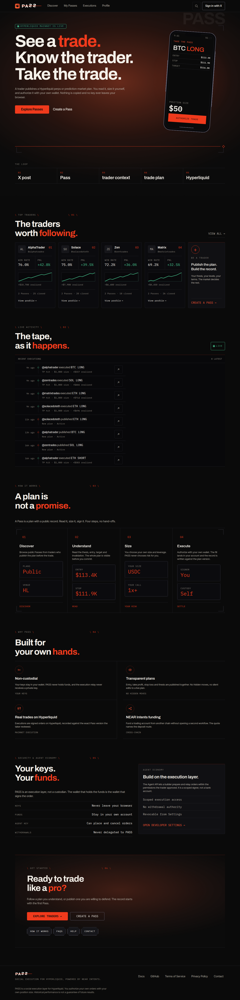
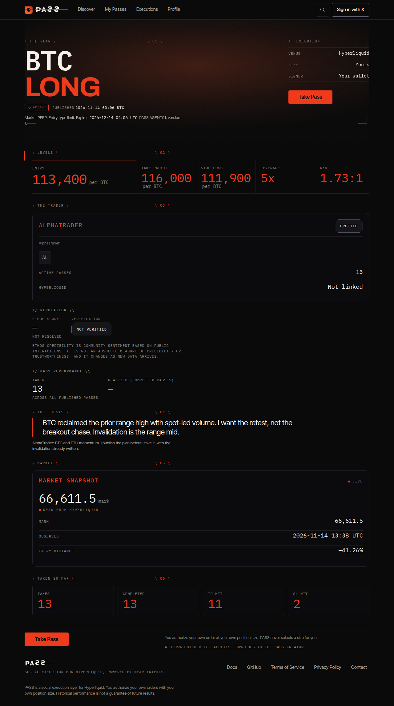
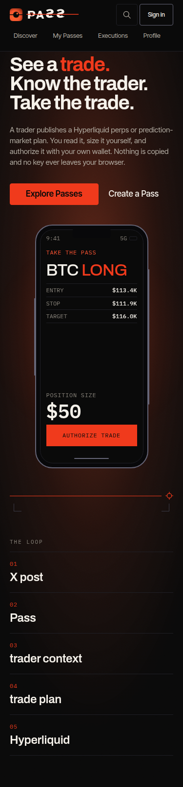
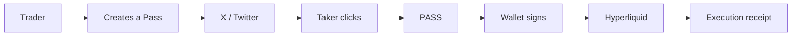

<p align="center">
  
</p>

<h1 align="center">PASS</h1>

<p align="center">
  <strong>See a trade. Know the trader. Take the trade.</strong>
</p>

<p align="center">
  <a href="https://pass-web-dun.vercel.app"></a>
  <a href="./LICENSE"></a>
  
  
</p>

PASS is a **social execution layer for Hyperliquid**. A trader publishes a
trade plan as a shareable **Pass**. A taker reads the plan, sizes the trade
themselves, and authorizes it with their own wallet. The plan is public. The
execution stays self-custodial.

---

## The problem

Trading alpha lives on Crypto Twitter, but the trade does not. By the time you
leave the timeline, open an exchange, and rebuild the position, the price has
moved. Copy-trading bots solve the speed problem by holding your funds and
asking you to trust their custody. Manual execution is slow, fragmented, and
easy to get wrong.

There should be a way to turn a public trade idea into an executable plan
without handing over a private key.

## The solution

**PASS turns a trade plan into a shareable, executable link.** The trader
publishes the thesis, levels, expiry, and risk. The taker chooses their own
size and signs the order from their own wallet. PASS relays the signed action
to Hyperliquid and records the execution against the exact Pass version that
was live when it was taken.

- **Non-custodial.** PASS never holds funds, seed phrases, or private keys.
- **Trader-led.** The plan is the public object; the size is the taker's call.
- **Auditable.** Every execution names the Pass version and provider order id.
- **Social.** Share the Pass on X and let the timeline execute with context.

---

## Screenshots

### Homepage

[](https://pass-web-dun.vercel.app)

### Pass detail

[](https://pass-web-dun.vercel.app/discover)

### Mobile



---

## How it works



1. The **Trader** connects X and publishes a Pass: asset, direction, entry,
   take profit, stop loss, leverage, thesis, and expiry.
2. The Pass is shared on **X** as a public link.
3. The **Taker** opens the Pass, reads the thesis, and chooses their own size.
4. PASS previews the exact order and fees. The taker's **wallet signs**.
5. **Hyperliquid** executes. PASS records the receipt against the Pass version.

Prediction markets use the same flow with binary HIP-4 YES/NO outcomes and
USDH collateral.

---

## Tech stack

| Layer | Choice |
|---|---|
| Web | Next.js 15, React 19, TypeScript |
| API | Fastify, Zod, Drizzle ORM |
| Database | Supabase Postgres; embedded PGlite locally |
| Execution | Hyperliquid API, client-signed actions |
| Funding | NEAR Intents / 1Click confidential cross-chain USDC |
| Extension | Chrome MV3, X overlay |
| Design | Custom stageshow system, tokens, editorial typography |

---

## Quick start

```bash
git clone https://github.com/onyebuchidaniel60/PASS.git
cd PASS
pnpm install
cp .env.example .env.local
pnpm --filter @pass/api dev
pnpm --filter @pass/web dev
```

The API runs on `http://localhost:4000` and the web app on
`http://localhost:3000`. Without `DATABASE_URL`, the API uses embedded PGlite
for local development.

Run the full verification suite:

```bash
pnpm test
pnpm -r typecheck
pnpm lint
```

---

## Links

- **Live app:** [pass-web-dun.vercel.app](https://pass-web-dun.vercel.app)
- **Documentation:** [pass-web-dun.vercel.app/docs](https://pass-web-dun.vercel.app/docs)
- **Agent API:** [pass-web-dun.vercel.app/developers](https://pass-web-dun.vercel.app/developers)
- **Docs index:** [docs/README.md](docs/README.md)
- **NEAR Hackathon:** [docs/NEAR_HACKATHON.md](docs/NEAR_HACKATHON.md)

---

## Chrome extension

A pre-built copy is committed at **`apps/extension/dist/`**. Judges and new
users can load it without Node or a build step.

### Install instantly (pre-built)

1. Download or clone this repository.
2. Open Chrome and go to `chrome://extensions`.
3. Enable **Developer mode** (top-right toggle).
4. Click **Load unpacked** and select:

   ```text
   apps/extension/dist
   ```

5. Open x.com in a new tab. The PASS overlay appears on supported profile
   pages.

### Build from source (developers)

```bash
pnpm install
pnpm --filter @pass/extension build
```

Then load `apps/extension/dist` with **Load unpacked**. After a rebuild, press
**Reload** on the extension card in `chrome://extensions`.

The extension targets the deployed API at
`https://pass-pz7f.onrender.com` and the web app at
`https://pass-web-dun.vercel.app`.

---

## Demo video

The 3-minute demo script, voiceover copy, and shot-by-shot storyboard live in
[`docs/DEMO_VIDEO.md`](docs/DEMO_VIDEO.md).

Generate the voiceover after adding your ElevenLabs credentials to
`.env.local`:

```bash
ELEVENLABS_API_KEY=...
ELEVENLABS_MODEL_ID=eleven_multilingual_v2
ELEVENLABS_VOICE_ID=...
pnpm generate:voiceover
```

The script writes `public/demo/voiceover.mp3`. Download a royalty-free lo-fi
or ambient synth track from Pixabay or Bensound, save it as
`public/demo/background.mp3`, and record the screen flow.

Assemble the final video:

```bash
ffmpeg \
  -i public/demo/screen-recording.mp4 \
  -i public/demo/voiceover.mp3 \
  -stream_loop -1 -i public/demo/background.mp3 \
  -filter_complex "[2:a]volume=0.15[bg];[1:a][bg]amix=inputs=2:duration=first:dropout_transition=2[a]" \
  -map 0:v -map "[a]" \
  -c:v copy -c:a aac -b:a 192k \
  -shortest public/demo/demo.mp4
```

The background music is intentionally not generated or committed; add a track
you have the right to use.

---

## Repository layout

```text
apps/web          Next.js web app, /docs, /developers
apps/api          Fastify API and in-process worker jobs
apps/extension    Chrome MV3 extension + committed dist/
packages/         Shared contracts, domain, db, integrations, ui
docs/             Source-of-truth documentation
design/           Visual blueprint and local-only reference media
scripts/          Verification, seed, and demo tooling
public/readme     README screenshots and logo
public/demo       Voiceover and video assembly assets
```

## License

MIT. See [LICENSE](./LICENSE).
